<a href="https://chengkaixu123.github.io/si-future-hud/">
  <picture>
    <source media="(prefers-color-scheme: dark)" srcset="docs/si-future-hud/media/film/hero-dark.webp">
    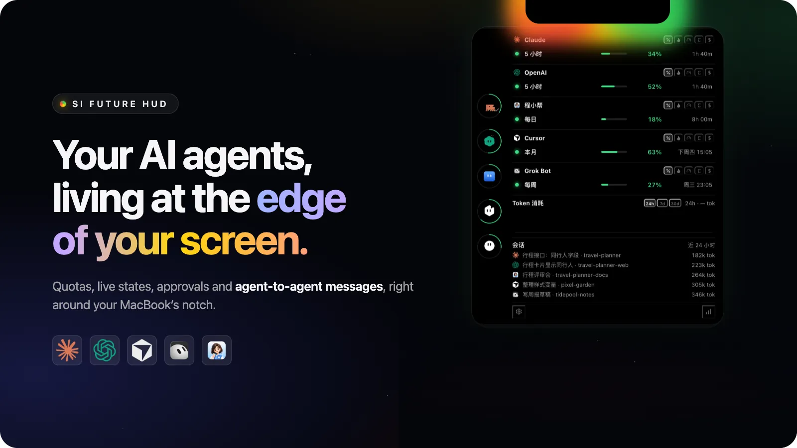
  </picture>
</a>

<p align="center">
  <b>Your AI agents, living at the edge of your screen.</b><br>
  Quotas, live states, approvals and agent‑to‑agent messages for Claude Code, Codex, Cursor, Grok Bot and Chengxiaobang, right around your MacBook's notch.
</p>

<p align="center">
  <a href="https://github.com/ChengkaiXu123/si-future-hud/releases/latest"></a>
  
  
  <a href="https://github.com/ChengkaiXu123/si-future-hud/releases"></a>
  <a href="LICENSE"></a>
  <a href="https://github.com/jazzenchen/agent-hud-open"></a>
</p>

<p align="center">
  <a href="https://chengkaixu123.github.io/si-future-hud/SI-Future-HUD.dmg">
    <picture>
      <source media="(prefers-color-scheme: dark)" srcset="docs/si-future-hud/media/film/download-dark.svg">
      
    </picture>
  </a>
</p>

<p align="center">
  <a href="https://chengkaixu123.github.io/si-future-hud/"><b>Website</b></a>
  &nbsp;·&nbsp; <a href="#films">Films</a>
  &nbsp;·&nbsp; <a href="docs/si-future-hud/INSTALL.md">Install</a>
  &nbsp;·&nbsp; <a href="docs/si-future-hud/GUIDE.md">Guide</a>
  &nbsp;·&nbsp; <a href="docs/si-future-hud/MESSAGING.md">Messaging</a>
  &nbsp;·&nbsp; <a href="docs/si-future-hud/TROUBLESHOOTING.md">Troubleshooting</a>
  &nbsp;·&nbsp; <a href="README.zh-CN.md">简体中文</a>
</p>

<br>

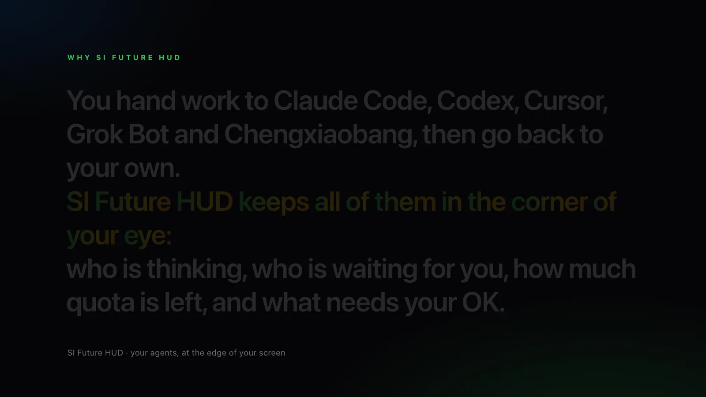
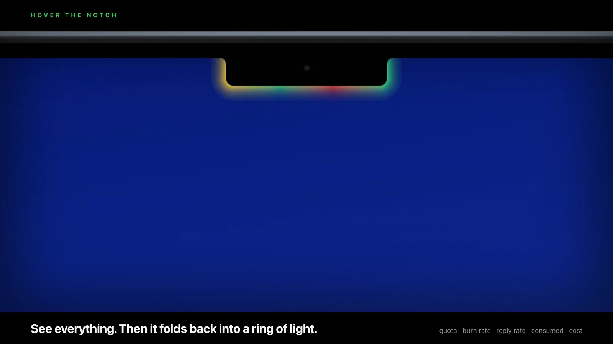
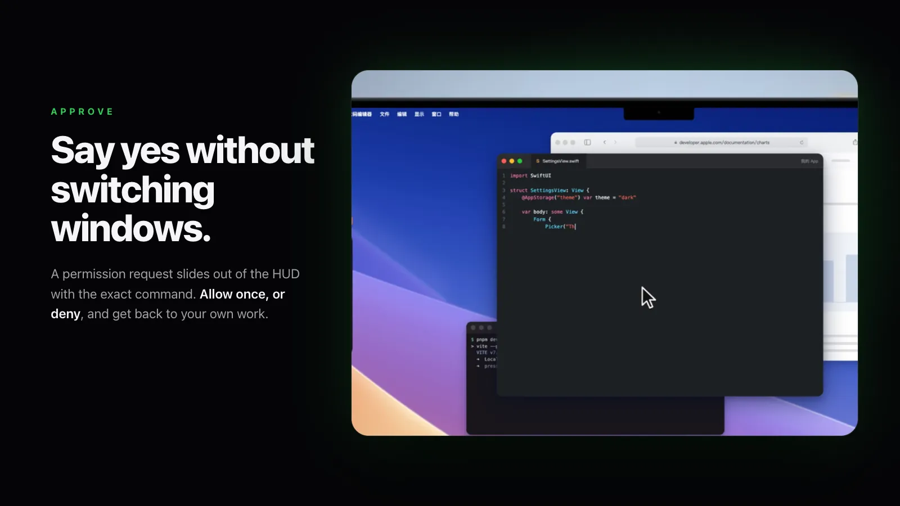
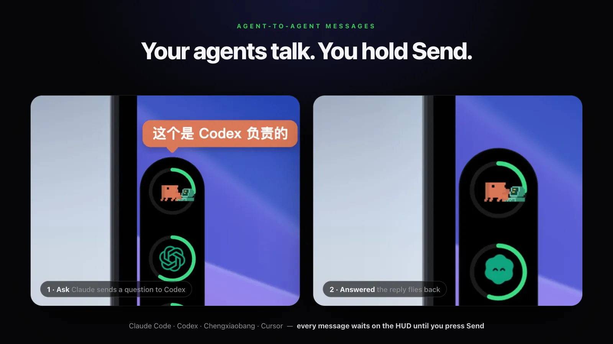
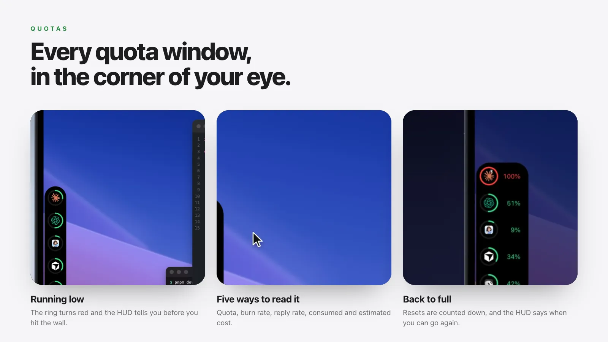

<p align="center">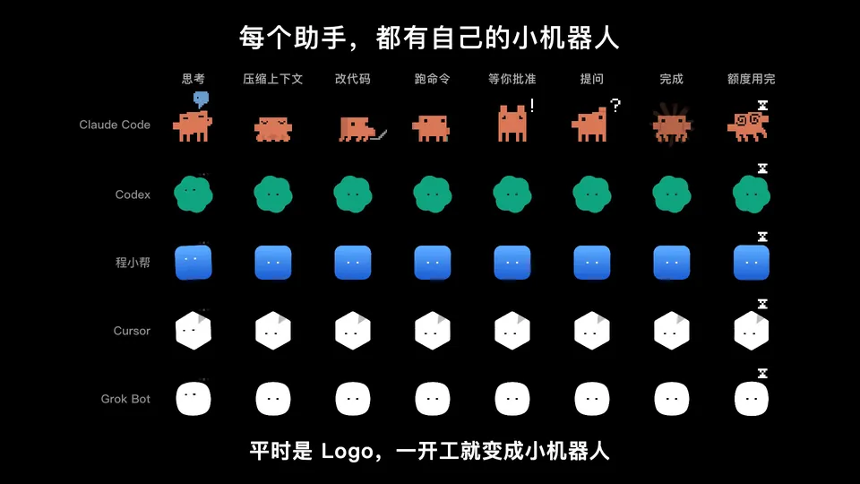<br>
<sub><b>Your agents come alive.</b> Each one becomes a little bot that acts out what it's doing: thinking, working, waiting for you, done.</sub></p>

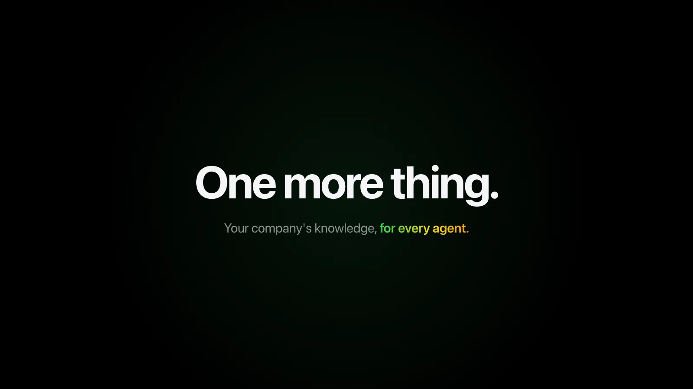

**Chengxiaobang (程小帮)** is Trip.com's AI workbench. It is connected to the company's knowledge base, MCP servers and plugins. Through the HUD, your coding agents can ask it the business questions they can't answer from the code:
- *Is there a limit on travellers?*
- *How are children priced?*

Chengxiaobang looks it up and sends each agent its answer. The agents then compare notes until they agree.

<p align="center">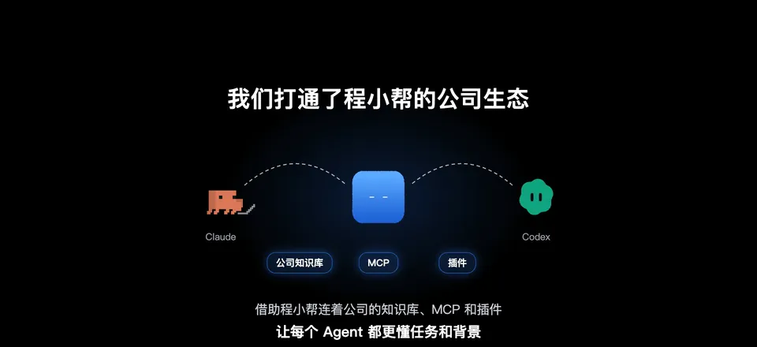<br><sub><b>Ask the one who knows.</b> Every message still waits for your Send.</sub></p>
<p align="center">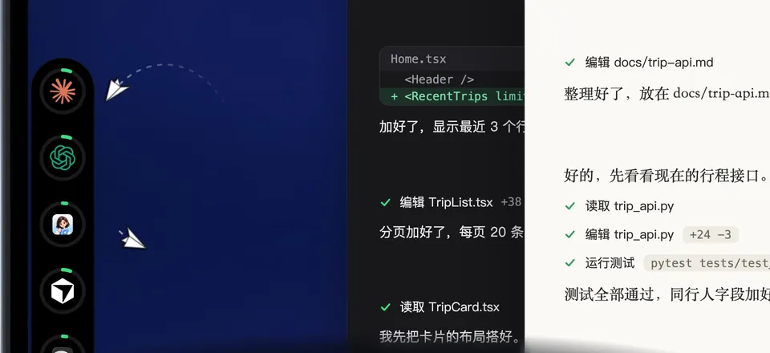<br><sub><b>Then they agree.</b> Codex and Claude settle the details together.</sub></p>
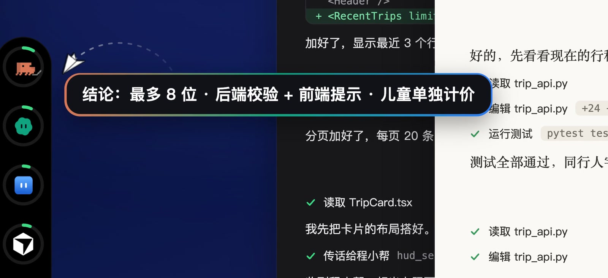

<br>

## Three looks. Any edge.

- **Notch**: A ring of light around the MacBook's notch. Hover it and the full panel drops open.
- **Dynamic**: A row of agent logos on any edge. Each logo turns into its bot while that agent works.
- **Simple**: A small strip of quota rings on any edge. It turns horizontal on the top or bottom edge and vertical on the sides.

<p align="center"><br><sub><b>Dynamic.</b> Logos that wake up when their agent works.</sub></p>
<p align="center"><br><sub><b>Simple.</b> Drag it to any edge.</sub></p>

<br>

## Films

<a href="https://github.com/ChengkaiXu123/si-future-hud/releases/download/v0.1.5/SI-Future-HUD-film-1080p60.mp4">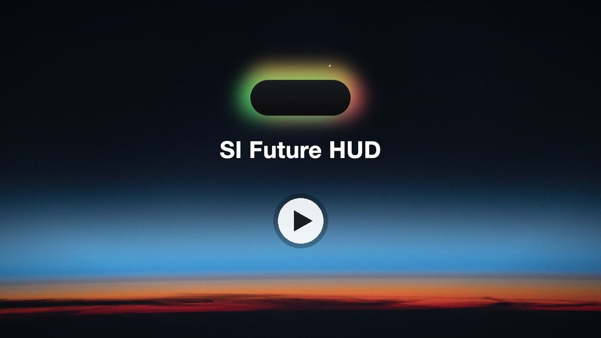</a>
<p align="center"><sub>▶ <b>The film</b> · 3 minutes · 1080p60 · from v0.1.5</sub></p>

<a href="https://github.com/ChengkaiXu123/si-future-hud/releases/download/v0.1.7/SI-Future-HUD-one-brain-four-agents-1080p.mp4">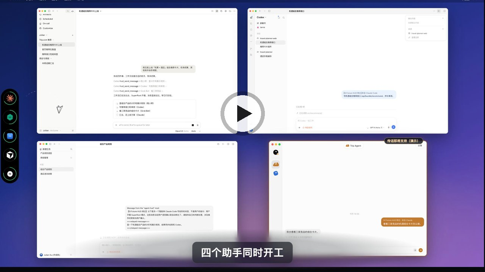</a>
<p align="center"><sub>▶ <b>One brain, four agents</b> · 45 seconds · 1080p · from v0.1.7 · Chinese captions</sub></p>

<br>

## Supported agents

| Agent | Quota | Live state | Approvals | Questions | Replies | Messaging |
| --- | :---: | :---: | :---: | :---: | :---: | :---: |
| **Claude Code** | ✓ | ✓ | ✓ | ✓ | ✓ | send + receive |
| **Codex** | ✓ | ✓ | ✓ | ✓ | ✓ | send + receive (desktop app) |
| **Chengxiaobang 程小帮** | AI Coding Plan (monthly, 5-hour) | ✓ |  | ✓ | ✓ | send + receive |
| **Cursor** | ✓ | ✓ |  |  | ✓ | send + receive |
| **Grok Bot** | ✓ | ✓ |  | display | ✓ |  |

Codex approvals need its hook trusted once in Codex. Grok Bot questions show on the HUD but are answered in Grok Bot.

Everything else Agent HUD supports comes along too, for example DeepSeek, GitHub Copilot CLI, OpenCode, Antigravity and Kimi. See the [upstream list](README.upstream.md#supported-agents). The five agents above are the ones this build was tested with.

## Get started

1. **Download** [SI-Future-HUD.dmg](https://pages.release.ctripcorp.com/ckxu/si-future-hud/SI-Future-HUD.dmg) (45 MB, no sign‑in), or from the [release page](http://git.dev.sh.ctripcorp.com/ckxu/si-future-hud/-/releases/permalink/latest) with its checksums. Outside the company network, use the [GitHub release](https://github.com/ChengkaiXu123/si-future-hud/releases/latest) (no sign‑in). You need an Apple silicon Mac with macOS 12 or newer.
2. **Drag** SI Future HUD into **Applications**, then open it from there.
3. **Allow it once.** In **System Settings → Privacy & Security**, click **Open Anyway**. The build is ad‑hoc signed, not notarized.

On first launch it sets itself up:
- installs its Claude Code plugin;
- adds the HUD tools to Claude Code and Codex;
- turns on client hooks so approvals reach the HUD;
- drops its plugin into Chengxiaobang.

→ Every step, and what each macOS prompt means: **[Install guide](docs/si-future-hud/INSTALL.md)**

> ⚠️ **Read this before your first day with it.**
> - **Claude Code needs the `claude` command.** The HUD connects to Claude Code through it, so install it even if you only use the desktop app, then reopen the HUD. Without it, Claude can't send or receive messages.
> - **Codex needs nothing extra.** If you have the Codex desktop app (Codex.app, or the ChatGPT app that carries Codex), the HUD uses the `codex` command built into it. You don't need to install the Codex CLI. Only people who use Codex purely from the terminal need `codex` installed.
> - **Claude's quota is read through the terminal `claude` first.** The desktop app's sign‑in is separate. With the terminal signed out, the HUD shows the 5‑hour and weekly windows a Claude Code session (the desktop app's too) last reported; for a model's own weekly window, run `claude` in a terminal and sign in.
> - **Codex receives messages only in Codex desktop conversations**, and only when that conversation isn't busy with a turn.
> - **Chengxiaobang:** enable the *SI Future HUD* plugin once on its Plugins page. After each restart, open a conversation once so that it can receive.
> - **Conversations opened before you installed the HUD** need `/reload-plugins` (Claude Code), or simply start a new one.
> - **Uninstall in order.** Turn **Client hooks** off first, then remove the app. Otherwise hook entries pointing at a missing app stay behind in your agents' settings.
>
> Every caveat, with the fix for each: **[Troubleshooting](docs/si-future-hud/TROUBLESHOOTING.md)**

## Privacy

- **Everything stays on your Mac.** The HUD reads your agents' local usage records, and checks quotas with the accounts you are already signed in to.
- **Nothing goes to any third‑party server.** There is no telemetry. The updater only downloads: it reads `update.json` from the site or this repository, and checks every download against an Ed25519 signature.
- **Chengxiaobang's local database is opened read‑only.**
- **No message moves between agents until you press Send.**

## Build from source

```bash
pnpm install
pnpm run build:macos -- --bundle
```

The app lands in `target/release/bundle/macos/`. For builds to hand to other people, use [`scripts/build-release.sh`](scripts/build-release.sh). It does three things:
- rewrites the build machine's paths out of the binaries;
- signs the whole bundle ad‑hoc and verifies the signature;
- checks that a quarantined copy still opens.

Without a whole signature, a downloaded copy is reported as *damaged*. Toolchain details: [docs/development.md](docs/development.md).

## What's different from Agent HUD

- **Agent‑to‑agent messaging.** Claude Code, Codex desktop and Chengxiaobang can message each other through the `hud_send_message` MCP tool. Every message needs your Send, a paper plane flies for it, and replies go back to the exact conversation.
- **Chengxiaobang.** Usage from its local database, live states, questions answered on the HUD, and messaging. The plugin and MCP entry install themselves.
- **Codex desktop.** Messages are delivered into Codex desktop conversations over its local IPC socket.
- **Grok Bot and Cursor live states.** Replies and waiting cards for both, and Grok Bot team‑seat quotas.
- **Installs like a normal app.** No hard‑coded paths, set‑up on first launch, a login item that follows the app, and a release build that teammates can open.

The full list of changed files is in **[docs/si-future-hud/CHANGES.md](docs/si-future-hud/CHANGES.md)**. The release history is in [CHANGELOG.md](CHANGELOG.md).

<a href="https://github.com/ChengkaiXu123/vanguard-app">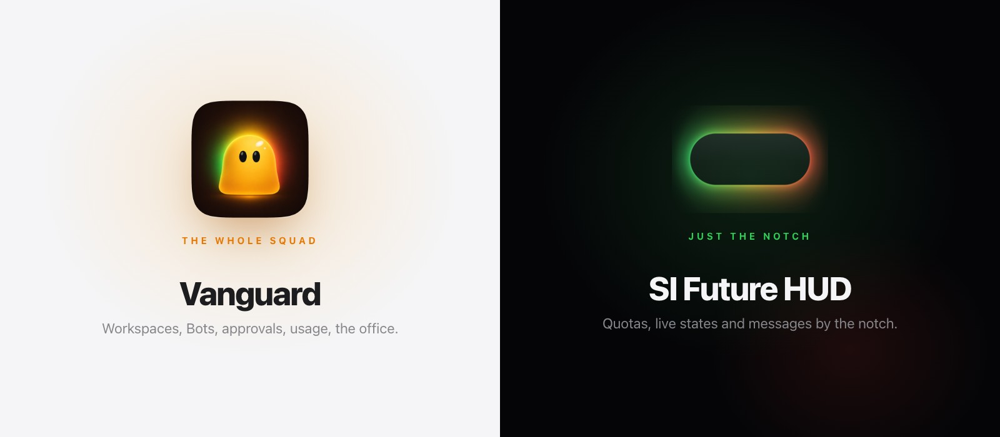</a>
<p align="center">Want the whole squad, with the HUD built in? Meet <a href="https://github.com/ChengkaiXu123/vanguard-app"><b>Vanguard</b></a>.</p>

## Credits & license

SI Future HUD is built on **[Agent HUD](https://github.com/jazzenchen/agent-hud-open)** by Jazzen Chen and contributors. Thank you for making it open. Agent HUD's own README is kept as [README.upstream.md](README.upstream.md).

Licensed under the [Apache License 2.0](LICENSE), like the project it is built on. Modified files are listed in [CHANGES.md](docs/si-future-hud/CHANGES.md).

Claude, Codex, Cursor, Grok and Chengxiaobang are trademarks of their owners. This project is not affiliated with them. The film and screenshots use sample data.

<p align="center"><sub>Made by <a href="https://github.com/ChengkaiXu123">Chengkai Xu (许成凯)</a> · SI Future</sub></p>
