<p align="center">
  <a href="https://pages.release.ctripcorp.com/ckxu/si-future-hud/media/film-1080p60.mp4">
    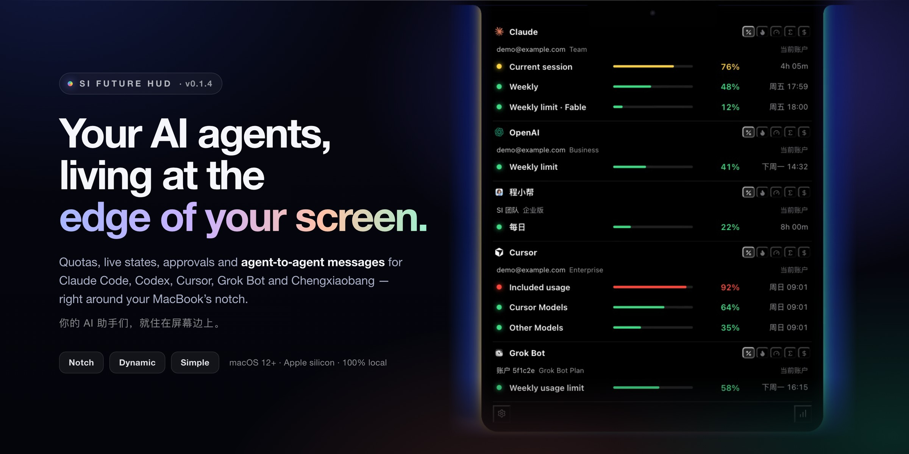
  </a>
</p>

<h1 align="center">SI Future HUD</h1>

<p align="center">
  <strong>你的 AI 助手们，就住在屏幕边上。</strong><br>
  额度、实时状态、审批，还有助手之间的互相传话，都在 MacBook 刘海旁边。
</p>

<p align="center">
  <a href="http://git.dev.sh.ctripcorp.com/ckxu/si-future-hud/-/releases/permalink/latest"></a>
  
  <a href="LICENSE"></a>
  <a href="https://github.com/jazzenchen/agent-hud-open"></a>
</p>

<p align="center">
  <a href="README.md">English</a> · <strong>简体中文</strong>
  &nbsp;|&nbsp;
  <a href="https://pages.release.ctripcorp.com/ckxu/si-future-hud/"><b>产品网页</b></a> ·
  <a href="https://pages.release.ctripcorp.com/ckxu/si-future-hud/media/film-1080p60.mp4">看宣传片</a> ·
  <a href="http://git.dev.sh.ctripcorp.com/ckxu/si-future-hud/-/releases/permalink/latest">下载</a> ·
  <a href="docs/si-future-hud/INSTALL.zh-CN.md">安装</a> ·
  <a href="docs/si-future-hud/GUIDE.zh-CN.md">使用指南</a> ·
  <a href="docs/si-future-hud/MESSAGING.zh-CN.md">互相传话</a> ·
  <a href="docs/si-future-hud/TROUBLESHOOTING.zh-CN.md">常见问题</a>
</p>

---

你把活交给 Claude Code、Codex、Cursor、Grok Bot 和程小帮，然后去忙自己的事。**SI Future HUD 让它们一直待在你的余光里：**
- 谁在思考，谁在等你；
- 每家还剩多少额度；
- 哪件事要你点头。

两个助手需要对一对口径时，现在可以互相发消息。每一条都会先停在 HUD 上，等你按「发送」。

SI Future HUD 基于开源项目 [Agent HUD](https://github.com/jazzenchen/agent-hud-open) 定制。在它之上加了：助手之间互相传话、接入程小帮、Cursor 和 Grok Bot 的实时状态，以及装好就自动配置。

<p align="center">
  <a href="https://pages.release.ctripcorp.com/ckxu/si-future-hud/media/film-1080p60.mp4">
    
  </a><br>
  <sub>▶ <b>看 3 分钟的宣传片</b>（1080p60，MP4，46 MB）· 片中均为演示数据</sub>
</p>

## 鼠标移上刘海，一切尽收眼底

鼠标移到刘海上，带发光边的刘海整块弹下来，变成一张竖排的面板，列出每个助手的：
- 账户和套餐；
- 每个额度窗口的进度条和重置时间；
- 五种看法：额度、消耗速度、回复速度、累计消耗、估算花费。

鼠标移开，它又收回成一圈安静的光。

<p align="center">
  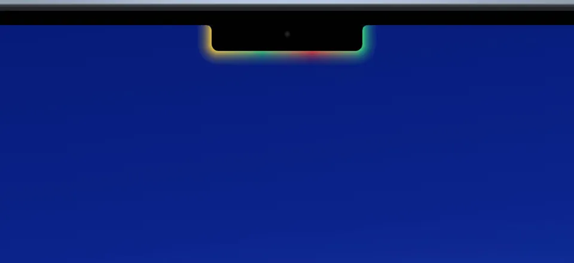
</p>

光圈的颜色跟着最紧的那份额度走：用量 70% 以下是绿色，70% 起变黄，90% 起变红。助手干活时，它会呼吸得更快。

## 每个助手都活了过来

每个助手都有一个小机器人，告诉你它此刻在做什么：
- **思考**；
- **压缩上下文**；
- **改代码**；
- **跑命令**；
- **等你批准**；
- **提问**；
- **完成**；
- **额度用完**。

不用切窗口就知道。

<p align="center">
  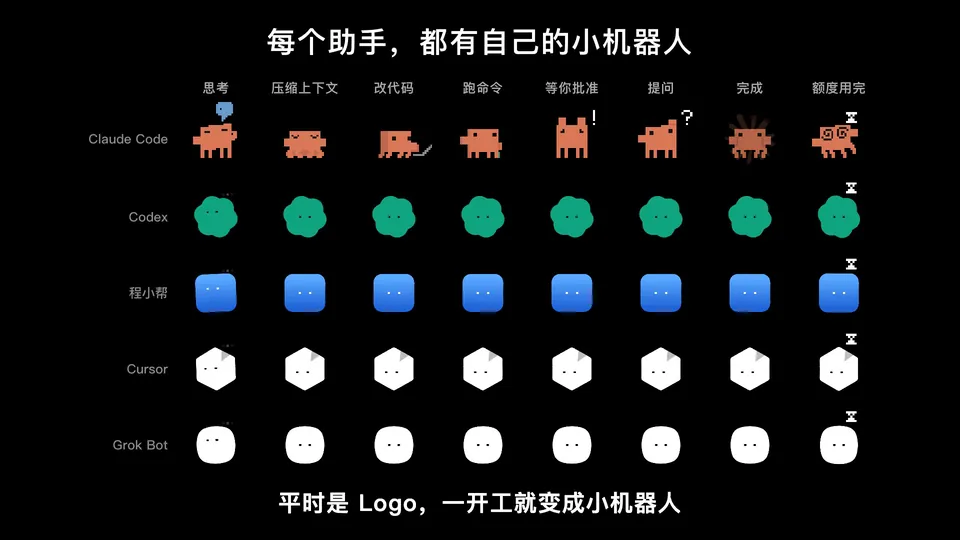
</p>

<table>
  <tr>
    <td width="50%">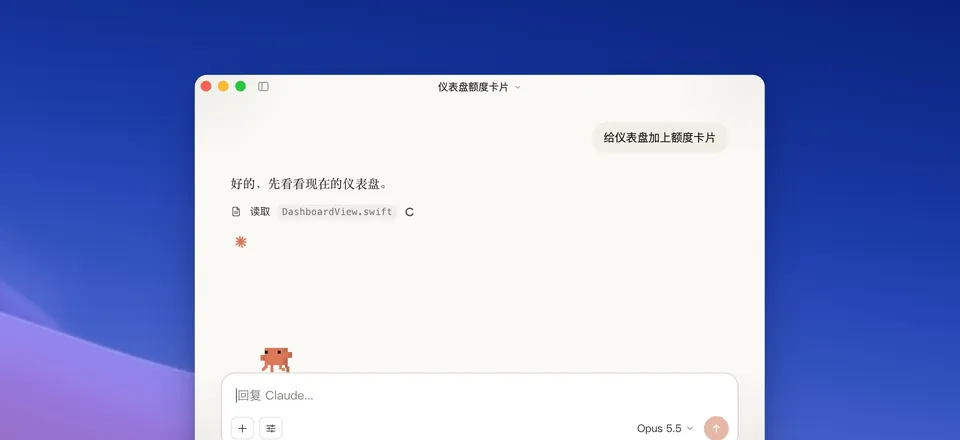</td>
    <td width="50%">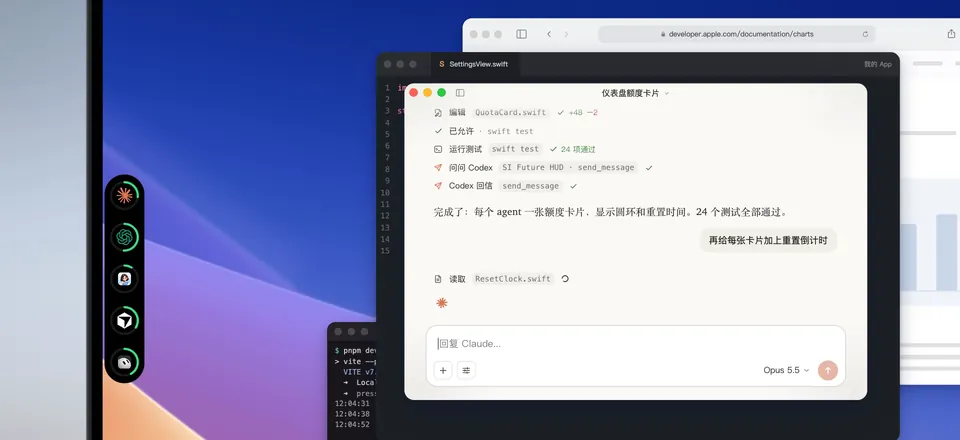</td>
  </tr>
  <tr>
    <td align="center"><sub><b>住在屏幕边上。</b>每个助手待在自己的额度圆环里。</sub></td>
    <td align="center"><sub><b>额度不会突然见底。</b>先提醒你，用完了小机器人就晕倒。</sub></td>
  </tr>
</table>

## 在 HUD 上直接处理

助手要执行命令时，请求会弹到 HUD 上，你不用离开手头的事就能点「批准一次」「拒绝」或「始终允许」。提问也一样，包括 Claude 在桌面 App 里问你的问题。

回复写完时，HUD 上会出现「有新回复」，点一下就回到那个对话。请求放着不管的话，10 分钟后会交还给助手，HUD 从不替你做决定。

<table>
  <tr>
    <td width="50%">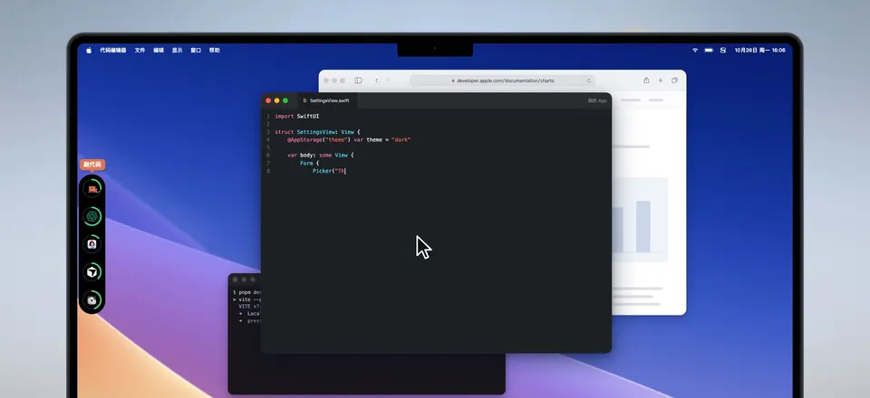</td>
    <td width="50%">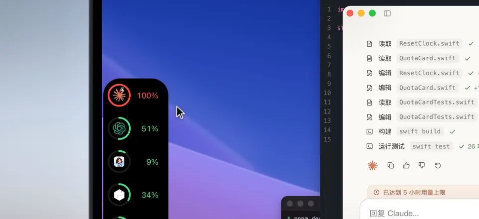</td>
  </tr>
  <tr>
    <td align="center"><sub><b>在 HUD 上审批。</b>完整命令看清楚，再点一下。</sub></td>
    <td align="center"><sub><b>细节随时看。</b>额度、token 和每个会话。</sub></td>
  </tr>
</table>

## 助手之间互相传话，每一条都经你同意

Claude Code、Codex（桌面版）和程小帮现在可以互相发消息。比如你让 Claude 去问问 Codex：Claude 调用 HUD 的 `hud_send_message` 工具，消息先停在 HUD 上，你点「发送」后，一架纸飞机把它送进 Codex 打开着的对话。回信会飞回发问的那个对话，不会送错。

<table>
  <tr>
    <td width="50%">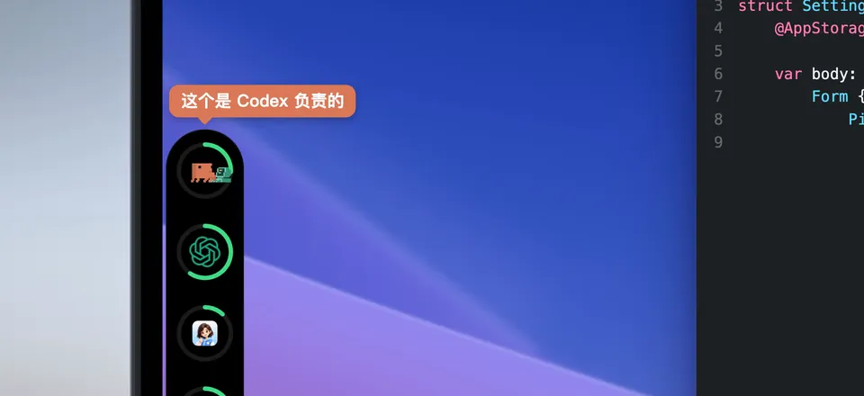</td>
    <td width="50%">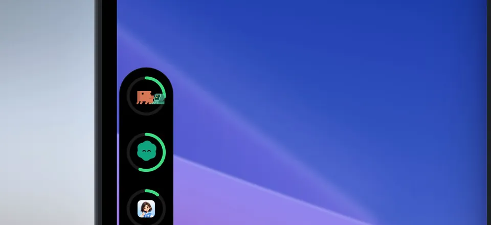</td>
  </tr>
  <tr>
    <td align="center"><sub><b>发问。</b>你点「发送」后，Claude → Codex。</sub></td>
    <td align="center"><sub><b>回信。</b>回到发问的那个对话。</sub></td>
  </tr>
</table>

不会有任何消息背着你发出去。你点「拒绝」，纸飞机就掉下来。→ [互相传话是怎么工作的](docs/si-future-hud/MESSAGING.zh-CN.md)

## One more thing：让每个助手都懂公司的业务

**程小帮**是携程的 AI 工作台，连着公司的知识库、MCP 和插件。通过 HUD，编程助手可以向它请教代码里找不到答案的业务问题：
- 同行人有人数上限吗？
- 儿童怎么计价？

程小帮查完资料，把答案分别送回给每个助手。助手们再互相讨论，直到达成一致。

<p align="center">
  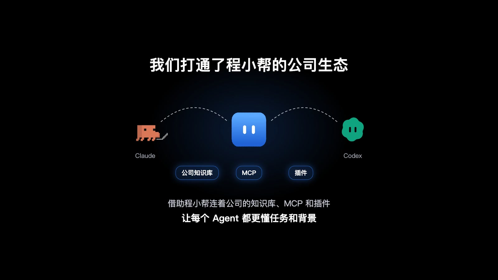
</p>

<table>
  <tr>
    <td width="50%">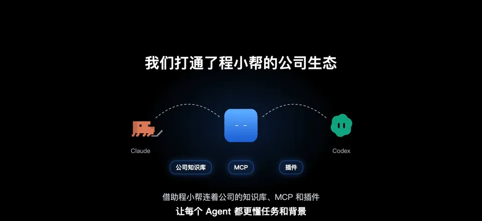</td>
    <td width="50%">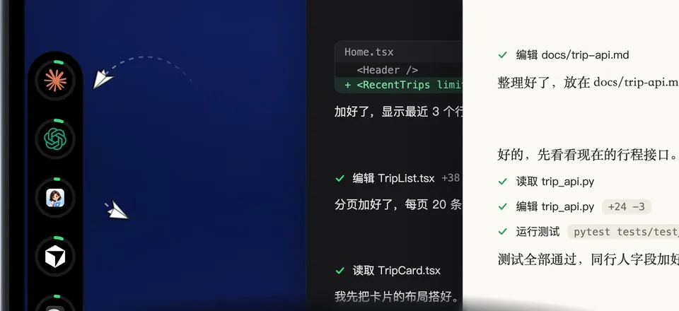</td>
  </tr>
  <tr>
    <td align="center"><sub><b>问懂行的人。</b>每一条照样要你点「发送」。</sub></td>
    <td align="center"><sub><b>再一起拍板。</b>Codex 和 Claude 把细节对齐。</sub></td>
  </tr>
</table>

<p align="center">
  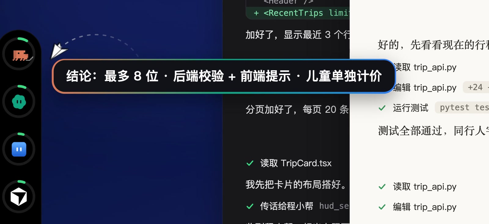
</p>

## 三种外观，任意一条屏幕边

| | |
| --- | --- |
| **刘海** | MacBook 刘海边的一圈光。鼠标移上去，完整面板弹下来。 |
| **动态** | 任意一条边上的一排图标。哪个助手在干活，它的图标就变成小机器人。 |
| **简约** | 任意一条边上的一小条额度圆环。放在上下边自动横排，放在左右边自动竖排。 |

<table>
  <tr>
    <td width="50%"></td>
    <td width="50%"></td>
  </tr>
  <tr>
    <td align="center"><sub><b>动态。</b>助手一干活，图标就醒过来。</sub></td>
    <td align="center"><sub><b>简约。</b>拖到哪条边都行。</sub></td>
  </tr>
</table>

## 支持的助手

| 助手 | 额度 | 实时状态 | 审批 | 提问 | 回复提醒 | 互相传话 |
| --- | :---: | :---: | :---: | :---: | :---: | :---: |
| **Claude Code** | ✓ | ✓ | ✓ | ✓ | ✓ | 能发能收 |
| **Codex** | ✓ | ✓ | ✓ | ✓ | ✓ | 能发能收（桌面版） |
| **程小帮** | 近 24 小时用量 | ✓ |  | ✓ | ✓ | 能发能收 |
| **Cursor** | ✓ | ✓ |  |  | ✓ |  |
| **Grok Bot** | ✓ | ✓ |  | 只显示 | ✓ |  |

Codex 的审批需要先在 Codex 里信任一次它的回调。Grok Bot 的提问会显示在 HUD 上，但要回到 Grok Bot 里回答。

Agent HUD 支持的其他助手也都保留，比如 DeepSeek、GitHub Copilot CLI、OpenCode、Antigravity、Kimi，见[上游列表](README.upstream.zh-CN.md#支持的-agent)。上表这五个是这个版本实际测过的。

## 开始使用

1. **下载**：直接下载 [SI-Future-HUD.dmg](https://pages.release.ctripcorp.com/ckxu/si-future-hud/SI-Future-HUD.dmg)（47 MB，免登录），或者到[发布页](http://git.dev.sh.ctripcorp.com/ckxu/si-future-hud/-/releases/permalink/latest)下载（带校验文件）。需要 Apple 芯片的 Mac，macOS 12 或更新。
2. **拖进「应用程序」**，再从「应用程序」里打开。
3. **放行一次**：在「系统设置 → 隐私与安全性」里点「仍要打开」。这是临时签名的内部版本，没有经过苹果公证。

第一次打开时，它会自动：
- 给 Claude Code 装好插件；
- 把 HUD 工具加进 Claude Code 和 Codex；
- 打开「客户端回调」，让审批能弹到 HUD 上；
- 给程小帮放好插件。

→ 每一步、每个系统弹窗是什么意思：**[安装指南](docs/si-future-hud/INSTALL.zh-CN.md)**

> ⚠️ **用之前请先看这几条。**
> - **Claude Code 要装 `claude` 命令。** HUD 通过这个命令接入 Claude Code，只用桌面版的话也要装上，再重开一次 HUD。没有它，Claude 收发不了传话。
> - **Codex 不用另装。** 装了 Codex 桌面版（Codex.app，或带 Codex 的 ChatGPT App）的，HUD 会直接用它自带的 `codex` 命令，不用再装 Codex 命令行版。只在终端里用 Codex、没装桌面版的，才需要装 `codex`。
> - **Claude 的额度要终端里的 `claude` 登录着。** 桌面 App 的登录和终端的不共用。面板里显示「Claude Code 已退出登录」时，在终端运行 `claude` 登录一次就好。
> - **Codex 只有桌面版的对话能收传话**，而且对方正在干活时收不了。
> - **程小帮**：在它的「插件」页启用一次 SI Future HUD 插件。程小帮每次重启后，要点开某个对话一次，那个对话才能收传话。
> - **装 HUD 之前就开着的对话**：在 Claude Code 里输入 `/reload-plugins`，或者直接新开一个对话。
> - **卸载要按顺序。** 先在设置里关掉「客户端回调」，再删 App。不然各个助手的设置里会留下指向已删除程序的回调条目。
>
> 所有注意事项和对应的解决办法：**[常见问题](docs/si-future-hud/TROUBLESHOOTING.zh-CN.md)**

## 隐私

- **所有数据都留在你的电脑上。** HUD 读取本机 AI 工具的使用记录，并用你已经登录的账号查询额度。
- **不向任何第三方服务器上报。** 没有遥测，也没有自动更新。
- **程小帮的本地数据库只读打开。**
- **你不点「发送」，助手之间一条消息也不会传。**

## 从源码构建

```bash
pnpm install
pnpm run build:macos -- --bundle
```

App 会生成在 `target/release/bundle/macos/`。要发给别人用的版本，请用 [`scripts/build-release.sh`](scripts/build-release.sh)，它会：
- 把构建机器的路径从二进制里抹掉；
- 给整个 App 做完整的临时签名并校验；
- 模拟别人下载后的情况，确认仍能打开。

签名不完整的话，别人下载后会被提示「已损坏」。工具链见 [docs/development.md](docs/development.md)。

## 和 Agent HUD 相比改了什么

- **助手之间互相传话**：Claude Code、Codex 桌面版和程小帮通过 MCP 工具 `hud_send_message` 互发消息。每条都要你点「发送」，配纸飞机动画，回信回到发问的那个对话。
- **接入程小帮**：从本地数据库读用量，实时状态，在 HUD 上回答它的提问，互相传话。插件和 MCP 条目自动安装。
- **Codex 桌面版**：通过本机 IPC 把消息送进 Codex 桌面版的对话。
- **Grok Bot 和 Cursor 的实时状态**：两者的回复提醒和等待卡片；Grok Bot 团队席位的额度。
- **像普通 App 一样安装**：不写死任何路径，首次启动自动配置，开机自启随 App 位置更新，打出来的安装包组员能直接打开。

改动的文件清单见 **[docs/si-future-hud/CHANGES.md](docs/si-future-hud/CHANGES.md)**，版本记录见 [CHANGELOG.md](CHANGELOG.md)。

## 致谢与许可

SI Future HUD 基于 Jazzen Chen 和贡献者们开发的 **[Agent HUD](https://github.com/jazzenchen/agent-hud-open)**，感谢他们把它开源。Agent HUD 原来的说明保留在 [README.upstream.zh-CN.md](README.upstream.zh-CN.md)。

和上游一样，采用 [Apache License 2.0](LICENSE)。改动过的文件列在 [CHANGES.md](docs/si-future-hud/CHANGES.md)。

Claude、Codex、Cursor、Grok、程小帮是各自所有者的商标，本项目与它们没有隶属关系。宣传片和截图里都是演示数据。

<p align="center"><sub>作者 <a href="http://git.dev.sh.ctripcorp.com/ckxu">许成凯 Chengkai Xu</a> · SI Future</sub></p>
