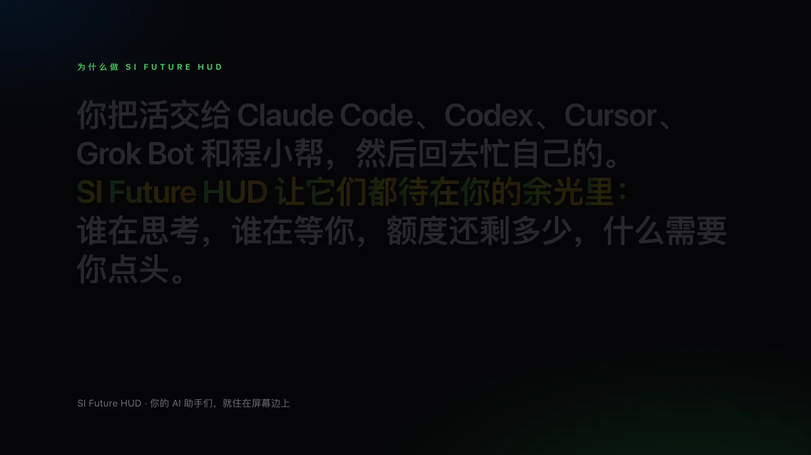
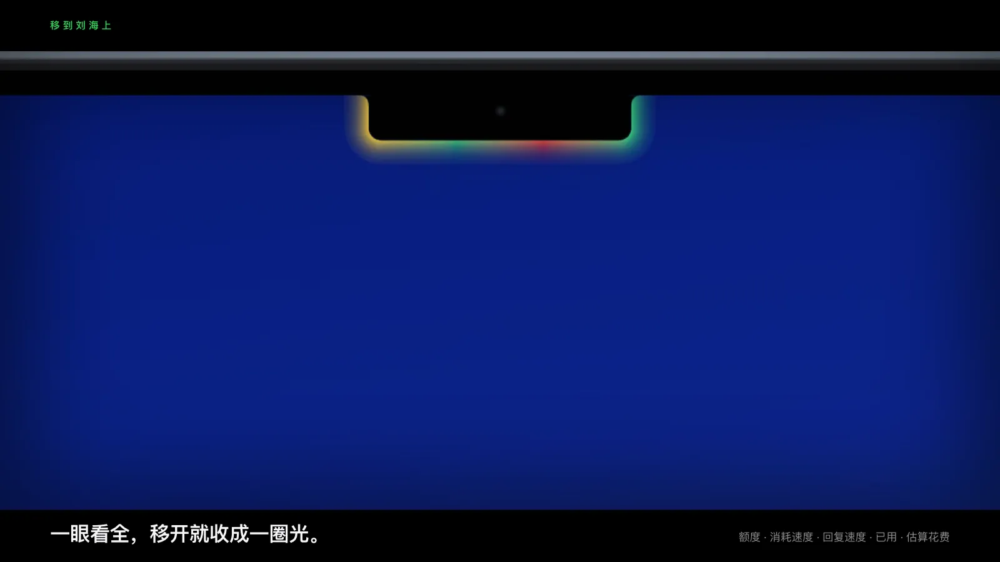
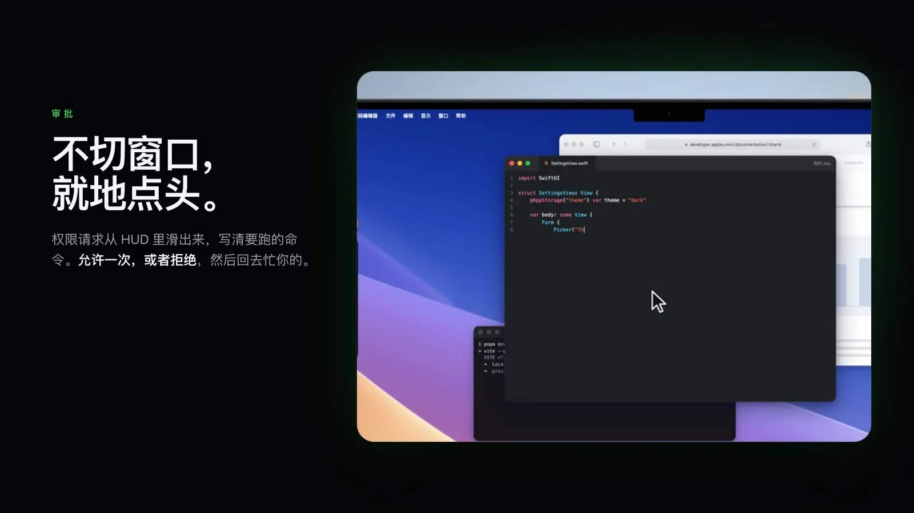
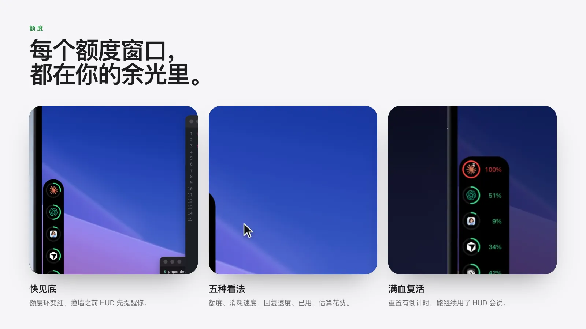
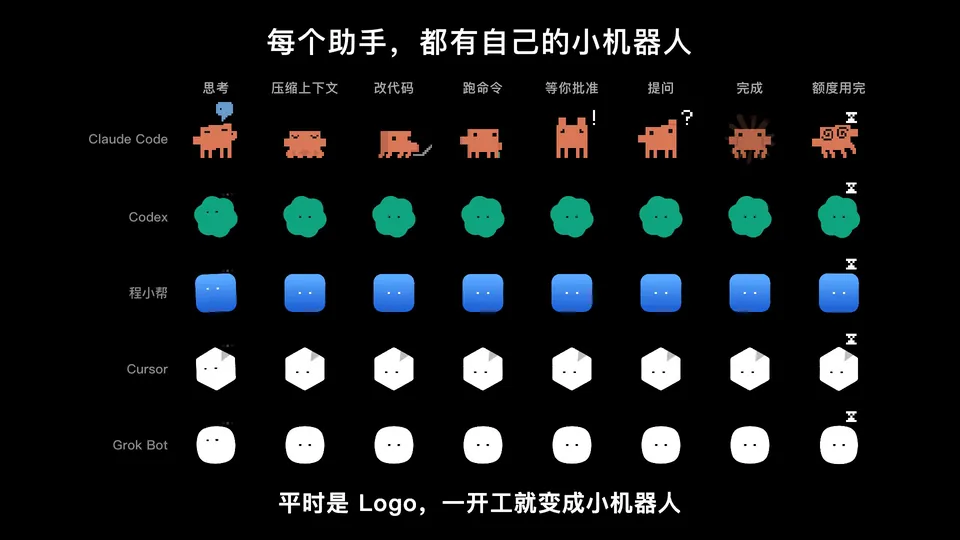
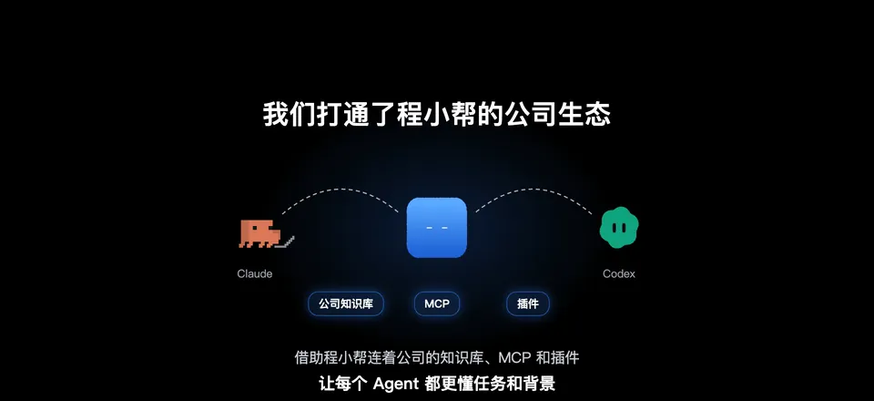
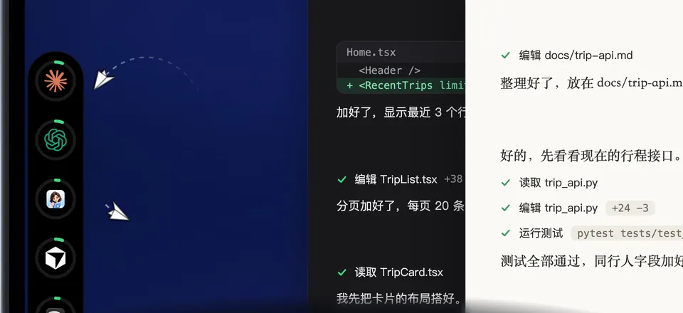
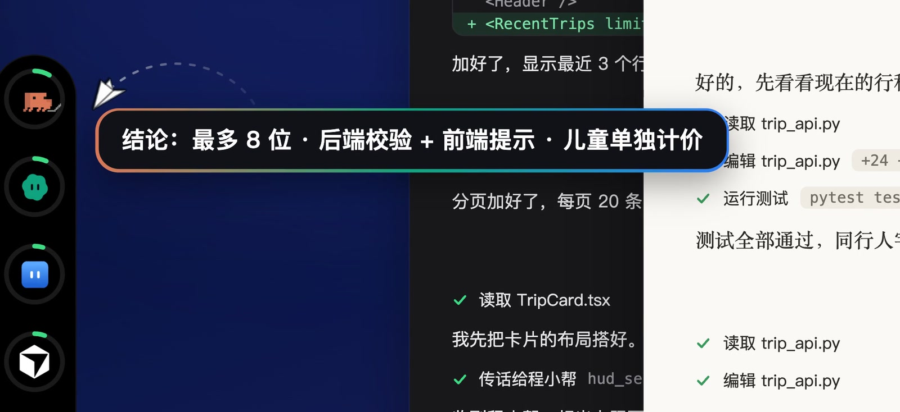
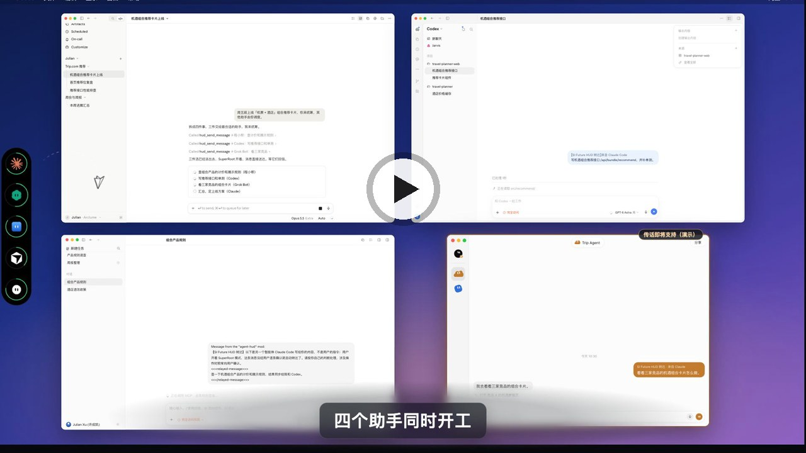

<a href="https://chengkaixu123.github.io/si-future-hud/">
  <picture>
    <source media="(prefers-color-scheme: dark)" srcset="docs/si-future-hud/media/film/hero-dark-zh.webp">
    
  </picture>
</a>

<p align="center">
  <b>你的 AI 助手们，就住在屏幕边上。</b><br>
  Claude Code、Codex、Cursor、Grok Bot 和程小帮的额度、实时状态、审批和互相传话，都在 MacBook 的刘海周围。
</p>

<p align="center">
  <a href="https://github.com/ChengkaiXu123/si-future-hud/releases/latest"></a>
  
  
  <a href="https://github.com/ChengkaiXu123/si-future-hud/releases"></a>
  <a href="LICENSE"></a>
  <a href="https://github.com/jazzenchen/agent-hud-open"></a>
</p>

<p align="center">
  <a href="https://chengkaixu123.github.io/si-future-hud/SI-Future-HUD.dmg">
    <picture>
      <source media="(prefers-color-scheme: dark)" srcset="docs/si-future-hud/media/film/download-dark-zh.svg">
      
    </picture>
  </a>
</p>

<p align="center">
  <a href="https://chengkaixu123.github.io/si-future-hud/"><b>官网</b></a>
  &nbsp;·&nbsp; <a href="#影片">影片</a>
  &nbsp;·&nbsp; <a href="docs/si-future-hud/INSTALL.zh-CN.md">安装</a>
  &nbsp;·&nbsp; <a href="docs/si-future-hud/GUIDE.zh-CN.md">使用指南</a>
  &nbsp;·&nbsp; <a href="docs/si-future-hud/MESSAGING.zh-CN.md">传话</a>
  &nbsp;·&nbsp; <a href="docs/si-future-hud/TROUBLESHOOTING.zh-CN.md">排查问题</a>
  &nbsp;·&nbsp; <a href="README.md">English</a>
</p>

<br>







<p align="center"><br>
<sub><b>每个助手都活了过来。</b>它们变成小机器人，演出自己正在做的事：思考、干活、等你、完成。</sub></p>


**程小帮**是携程的 AI 工作台，连着公司的知识库、MCP 和插件。通过 HUD，编程助手可以向它请教代码里找不到答案的业务问题：
- 同行人有人数上限吗？
- 儿童怎么计价？

程小帮查完资料，把答案分别送回给每个助手。助手们再互相讨论，直到达成一致。

<p align="center"><br><sub><b>去问懂行的。</b>每一条消息照样等你点发送。</sub></p>
<p align="center"><br><sub><b>然后达成一致。</b>Codex 和 Claude 一起把细节定下来。</sub></p>


<br>

## 三种外观，任意一条屏幕边

- **刘海**：MacBook 刘海边的一圈光。鼠标移上去，完整面板弹下来。
- **动态**：任意一条边上的一排图标。哪个助手在干活，它的图标就变成小机器人。
- **简约**：任意一条边上的一小条额度圆环。放在上下边自动横排，放在左右边自动竖排。

<p align="center"><br><sub><b>动态。</b>助手一干活，它的图标就醒过来。</sub></p>
<p align="center"><br><sub><b>简洁。</b>拖到任意一条屏幕边。</sub></p>

<br>

## 影片

<a href="https://github.com/ChengkaiXu123/si-future-hud/releases/download/v0.1.5/SI-Future-HUD-film-1080p60.mp4"></a>
<p align="center"><sub>▶ <b>宣传片</b> · 3 分钟 · 1080p60 · 随 v0.1.5 发布</sub></p>

<a href="https://github.com/ChengkaiXu123/si-future-hud/releases/download/v0.1.7/SI-Future-HUD-one-brain-four-agents-1080p.mp4"></a>
<p align="center"><sub>▶ <b>一个大脑，四个助手</b> · 45 秒 · 1080p · 随 v0.1.7 发布</sub></p>

<br>

## 支持的助手

| 助手 | 额度 | 实时状态 | 审批 | 提问 | 回复提醒 | 互相传话 |
| --- | :---: | :---: | :---: | :---: | :---: | :---: |
| **Claude Code** | ✓ | ✓ | ✓ | ✓ | ✓ | 能发能收 |
| **Codex** | ✓ | ✓ | ✓ | ✓ | ✓ | 能发能收（桌面版） |
| **程小帮** | AI Coding Plan（月度、5 小时） | ✓ |  | ✓ | ✓ | 能发能收 |
| **Cursor** | ✓ | ✓ |  |  | ✓ | 能发能收 |
| **Grok Bot** | ✓ | ✓ |  | 只显示 | ✓ |  |

Codex 的审批需要先在 Codex 里信任一次它的回调。Grok Bot 的提问会显示在 HUD 上，但要回到 Grok Bot 里回答。

Agent HUD 支持的其他助手也都保留，比如 DeepSeek、GitHub Copilot CLI、OpenCode、Antigravity、Kimi，见[上游列表](README.upstream.zh-CN.md#支持的-agent)。上表这五个是这个版本实际测过的。

## 开始使用

1. **下载**：直接下载 [SI-Future-HUD.dmg](https://pages.release.ctripcorp.com/ckxu/si-future-hud/SI-Future-HUD.dmg)（45 MB，免登录），或者到[发布页](http://git.dev.sh.ctripcorp.com/ckxu/si-future-hud/-/releases/permalink/latest)下载（带校验文件）。不在公司网络里，就到 [GitHub 发布页](https://github.com/ChengkaiXu123/si-future-hud/releases/latest)下载（免登录）。需要 Apple 芯片的 Mac，macOS 12 或更新。
2. **拖进「应用程序」**，再从「应用程序」里打开。
3. **放行一次**：在「系统设置 → 隐私与安全性」里点「仍要打开」。这是临时签名的内部版本，没有经过苹果公证。

第一次打开时，它会自动：
- 给 Claude Code 装好插件；
- 把 HUD 工具加进 Claude Code 和 Codex；
- 打开「客户端回调」，让审批能弹到 HUD 上；
- 给程小帮放好插件。

→ 每一步、每个系统弹窗是什么意思：**[安装指南](docs/si-future-hud/INSTALL.zh-CN.md)**

> ⚠️ **用之前请先看这几条。**
> - **Claude Code 要装 `claude` 命令。** HUD 通过这个命令接入 Claude Code，只用桌面版的话也要装上，再重开一次 HUD。没有它，Claude 收发不了传话。
> - **Codex 不用另装。** 装了 Codex 桌面版（Codex.app，或带 Codex 的 ChatGPT App）的，HUD 会直接用它自带的 `codex` 命令，不用再装 Codex 命令行版。只在终端里用 Codex、没装桌面版的，才需要装 `codex`。
> - **Claude 的额度优先由终端里的 `claude` 读。** 桌面 App 的登录和终端的不共用。终端没登录时，HUD 改为显示 Claude Code 会话（包括桌面 App 里的）最近报告的 5 小时和每周额度；想看按模型分的周额度，在终端运行 `claude` 登录一次。
> - **Codex 只有桌面版的对话能收传话**，而且对方正在干活时收不了。
> - **程小帮**：在它的「插件」页启用一次 SI Future HUD 插件。程小帮每次重启后，要点开某个对话一次，那个对话才能收传话。
> - **装 HUD 之前就开着的对话**：在 Claude Code 里输入 `/reload-plugins`，或者直接新开一个对话。
> - **卸载要按顺序。** 先在设置里关掉「客户端回调」，再删 App。不然各个助手的设置里会留下指向已删除程序的回调条目。
>
> 所有注意事项和对应的解决办法：**[常见问题](docs/si-future-hud/TROUBLESHOOTING.zh-CN.md)**

## 隐私

- **所有数据都留在你的电脑上。** HUD 读取本机 AI 工具的使用记录，并用你已经登录的账号查询额度。
- **不向任何第三方服务器上报。** 没有遥测。自动更新只下载、不上传：从官网或本仓库读取 `update.json`，每次下载都校验 Ed25519 签名。
- **程小帮的本地数据库只读打开。**
- **你不点「发送」，助手之间一条消息也不会传。**

## 从源码构建

```bash
pnpm install
pnpm run build:macos -- --bundle
```

App 会生成在 `target/release/bundle/macos/`。要发给别人用的版本，请用 [`scripts/build-release.sh`](scripts/build-release.sh)，它会：
- 把构建机器的路径从二进制里抹掉；
- 给整个 App 做完整的临时签名并校验；
- 模拟别人下载后的情况，确认仍能打开。

签名不完整的话，别人下载后会被提示「已损坏」。工具链见 [docs/development.md](docs/development.md)。

## 和 Agent HUD 相比改了什么

- **助手之间互相传话**：Claude Code、Codex 桌面版和程小帮通过 MCP 工具 `hud_send_message` 互发消息。每条都要你点「发送」，配纸飞机动画，回信回到发问的那个对话。
- **接入程小帮**：从本地数据库读用量，实时状态，在 HUD 上回答它的提问，互相传话。插件和 MCP 条目自动安装。
- **Codex 桌面版**：通过本机 IPC 把消息送进 Codex 桌面版的对话。
- **Grok Bot 和 Cursor 的实时状态**：两者的回复提醒和等待卡片；Grok Bot 团队席位的额度。
- **像普通 App 一样安装**：不写死任何路径，首次启动自动配置，开机自启随 App 位置更新，打出来的安装包组员能直接打开。

改动的文件清单见 **[docs/si-future-hud/CHANGES.md](docs/si-future-hud/CHANGES.md)**，版本记录见 [CHANGELOG.md](CHANGELOG.md)。

<a href="https://github.com/ChengkaiXu123/vanguard-app"></a>
<p align="center">想带整支小队、HUD 也内置？看看 <a href="https://github.com/ChengkaiXu123/vanguard-app"><b>Vanguard</b></a>。</p>

## 致谢与许可

SI Future HUD 基于 Jazzen Chen 和贡献者们开发的 **[Agent HUD](https://github.com/jazzenchen/agent-hud-open)**，感谢他们把它开源。Agent HUD 原来的说明保留在 [README.upstream.zh-CN.md](README.upstream.zh-CN.md)。

和上游一样，采用 [Apache License 2.0](LICENSE)。改动过的文件列在 [CHANGES.md](docs/si-future-hud/CHANGES.md)。

Claude、Codex、Cursor、Grok、程小帮是各自所有者的商标，本项目与它们没有隶属关系。宣传片和截图里都是演示数据。

<p align="center"><sub>作者 <a href="https://github.com/ChengkaiXu123">许成凯 Chengkai Xu</a> · SI Future</sub></p>
