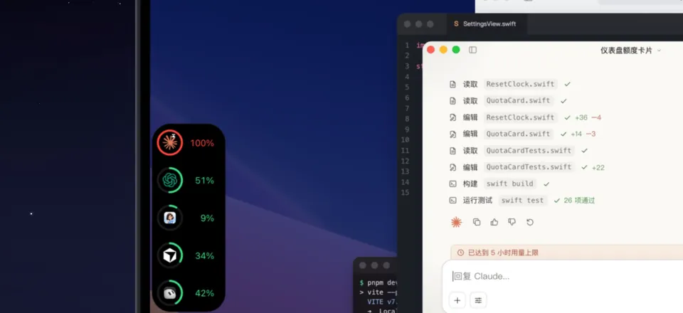

<a href="GUIDE.md">English</a> · <strong>简体中文</strong>

# SI Future HUD 使用指南

HUD 上显示的所有东西，以及你能在上面做什么。打开设置的方法：点菜单栏里的 SI Future HUD 图标 →「设置」。

## 三种外观

每块屏幕可以有自己的外观，在「设置 → 显示器」里选（每块屏幕单独设置）。

| 外观 | 你会看到 | 适合 |
| --- | --- | --- |
| **刘海** | MacBook 刘海边的一圈光。鼠标移上去，刘海弹下来变成完整面板。 | 带刘海的 MacBook，完全不占屏幕空间。 |
| **动态** | 任意一条屏幕边上的一排助手图标，背后有光晕。哪个助手在干活，它的图标就变成**小机器人**。 | 一眼看出谁在忙。 |
| **简约** | 任意一条边上的一小条**额度圆环**，每个助手一个。打开「显示数字」可以看到百分比。 | 外接显示器、屏幕左右两侧。 |

**挪位置**：动态和简约模式可以拖到四条边中的任意一条。放在上下边自动横排，放在左右边自动竖排。「重置位置」可以放回原处。

  
  

## 一眼看懂

- **颜色代表额度。** 每个助手的颜色跟着它最紧的那个额度窗口走：用量 70% 以下**绿色**，70% 起**黄色**，90% 起**红色**。
- **动起来代表在干活。** 助手干活时光晕呼吸得更快，只有在忙的那个助手的圆环和图标会动。
- **显示已用还是剩余。** 「设置 → 通用 → 用量显示」可以把所有百分比切换成**已用（0% → 100%）**或**剩余（100% → 0%）**。颜色始终按已用量算。

### 小机器人在做什么

每个助手都有自己的小机器人。下面以 Claude 的 **Clawd** 为例，其他助手用各自的样子表演同样的状态，见下面的图鉴。

| 状态 | Clawd 的样子 |
| --- | --- |
| **思考** | 在琢磨 |
| **读文件** | 在看书 |
| **改代码** | 对着笔记本敲键盘 |
| **跑命令** | 对着台式机干活 |
| **压缩上下文** | 打坐 |
| **等你批准** | 指着你，头上一个 `!` |
| **向你提问** | 挥手，头上一个 `?` |
| **完成**（回复写好了） | 欢呼 |
| **额度用完** | 晕倒 |

## 面板

鼠标移到 HUD（或刘海）上，面板就会打开。也可以设成按住 **Option** 才展开：在「设置 → 显示器 → 悬停交互」里，展开延迟和收起延迟也在那里调。

每个助手占一块：

- **名称和账户**：当前登录的账户和套餐，标着「当前账户」。
- **每个额度窗口一行**：比如 Claude 的 *Current session*、*Weekly*、*Weekly limit · Fable*，Cursor 的 *Included usage*、*Cursor Models*、*Other Models*。每行有进度条、百分比和重置时间。
- **五种看法**：每块右上角的按钮切换：

  | 按钮 | 显示 |
  | :---: | --- |
  | **%** | **额度**：每个窗口的用量占比 |
  | 🔥 | **消耗速度**：这个周期每小时消耗几个百分点 |
  | ◔ | **回复速度**：每秒多少 token |
  | **Σ** | **累计消耗**：这个周期用了多少 token |
  | **$** | **估算花费** |

各块下面还可以显示：
- **Token 消耗**：近 24 小时、7 天或 30 天，按助手堆叠显示。
- **会话列表**：最近的对话，等你处理的排在最前。点开能看到轮次、上下文、token 和子 agent。

这两块的开关在「设置 → 显示器 → 展开面板」。「按 agent 分开」会让每个助手各有一张卡片，而不是共用一个面板。

## 审批和提问

助手要权限时（比如「运行 `swift test`？」），请求会带着完整命令弹到 HUD 上：

- **批准一次**：这一次放行。
- **拒绝**：不让执行，助手会收到拒绝。
- **始终允许**：以后这类操作都放行，和在助手自己的设置里允许一样。

提问会列出选项，点一个就是回答，包括 Claude 在桌面 App 里问你的问题。

- **决定权一直在你手里。** 请求放着不管的话，10 分钟后会交还给助手，HUD 从不替你回答。
- **需要「客户端回调」。** 首次启动时自动打开，位置在「设置 → 通用」。想回到各个 App 里自己审批，就把它关掉。
- **程小帮的提问**也能在 HUD 上回答，开关在「设置 → 智能体插件 → 程小帮 → 回答提问」。
- **Grok Bot 的提问卡片**只在 HUD 上显示，回答要回到 Grok Bot 里。

## 回复提醒

助手完成时，HUD 上会滑出「有新回复」卡片。点「回到会话」，那个对话就会到最前面：Claude 或 Codex 的那个对话；终端里的会话目前只支持跳到 iTerm2 的标签页（不在 tmux 里时），Terminal.app、Ghostty 等其他终端还跳不过去。程小帮会打开 App。

## 快用完、用完了、重新开始

- **额度窗口快用完时**，HUD 会提醒你，颜色变红。
- **用完了**，那个助手的小机器人会晕倒，HUD 提示额度已耗尽。
- **窗口重置时**，弹出「已重置」，圆环和颜色回到绿色。

  
  

## 助手之间互相传话

Claude Code、Codex（桌面版）和程小帮可以通过 HUD 互相发消息，每一条都要你点「发送」。→ **[互相传话](MESSAGING.zh-CN.md)**

## 多块屏幕

每块屏幕各自保存外观和位置，比如 MacBook 上用刘海、外接显示器上用简约。设置「没生效」时，先看看改的是不是你正在看的那块屏幕。

## 设置在哪里

| 设置 | 位置 |
| --- | --- |
| 外观、大小、光晕、位置、面板显示哪些部分 | 设置 →「**显示器**」（每块屏幕单独） |
| 已用 / 剩余百分比、语言、主题 | 设置 →「**通用**」 |
| **客户端回调**（在 HUD 上审批） | 设置 →「**通用 → 客户端**」 |
| **登录时启动** | 设置 →「**通用 → 启动**」 |
| Claude Code 插件、程小帮插件、「回答提问」 | 设置 →「**智能体插件**」 |
| Claude Code 和 Codex 的 HUD 工具（MCP）、其他助手 | 设置 →「**智能体插件**」/「**其他智能体**」 |

---

接下来：**[互相传话](MESSAGING.zh-CN.md)** · **[常见问题](TROUBLESHOOTING.zh-CN.md)** · 回到 **[首页](../../README.zh-CN.md)**
