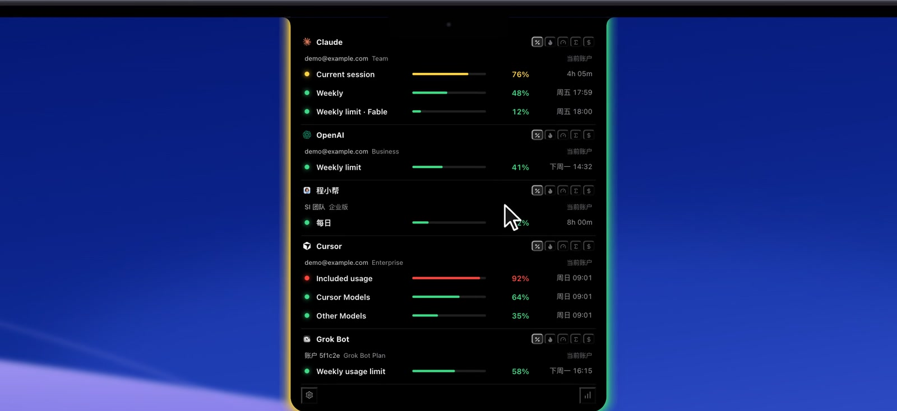

<p align="right"><a href="INSTALL.md">English</a> · <strong>简体中文</strong></p>

# 安装 SI Future HUD

大约五分钟，大部分时间花在 macOS 问你信不信任这个 App 上。

<p align="center"></p>

## 开始之前

| 需要 | 为什么 |
| --- | --- |
| **Apple 芯片的 Mac**（M1、M2、M3、M4…），**macOS 12 或更新** | 安装包只有 arm64 版本。查看方法：苹果菜单 →「关于本机」，「芯片」一栏是 Apple M 开头就行。Intel 芯片的 Mac 请[从源码构建](../../README.zh-CN.md#从源码构建)。 |
| **`claude` 命令**（Claude Code 命令行版），如果你用 Claude Code | HUD 通过这个命令给 Claude Code 装插件和工具。**只装桌面版不够。** |
| **Codex 桌面版**，如果你用 Codex | 不用另装别的。HUD 用桌面版自带的 `codex` 命令（Codex.app，或带 Codex 的 ChatGPT App）给 Codex 装工具，发**给** Codex 的消息也送到桌面版。**不用装 Codex 命令行版。** 只在终端里用 Codex 的，HUD 才需要在下面这些位置找到 `codex` 命令。 |
| **程小帮**，如果你用它 | 不用准备，HUD 会自己放好插件；装好后在程小帮里启用一次（见下文）。 |

**怎么装命令行版**：按各家官方说明安装：
- Claude Code：[docs.claude.com → Claude Code → Set up](https://docs.claude.com/en/docs/claude-code/setup)
- Codex（只在没有 Codex 桌面版时需要）：[github.com/openai/codex](https://github.com/openai/codex)

HUD 会在这些位置找它们：`~/.local/bin`、`~/.bun/bin`、`~/.npm-global/bin`、`/opt/homebrew/bin`、`/usr/local/bin`、`/usr/bin`、`/bin`，以及你的 `PATH`。

晚点再装也可以，HUD 每次启动都会重新尝试。

## 1 · 下载

最快的方式：直接下载 **[SI-Future-HUD.dmg](https://pages.release.ctripcorp.com/ckxu/si-future-hud/SI-Future-HUD.dmg)**（45 MB，免登录）。也可以到[发布页](http://git.dev.sh.ctripcorp.com/ckxu/si-future-hud/-/releases/permalink/latest)（需登录公司 GitLab）下载：

- `SI-Future-HUD_0.1.4_aarch64.dmg`：安装包
- `SHA256SUMS.txt`：校验值（想确认下载完整时用）

校验方法：在下载文件夹里打开终端，运行：

```bash
shasum -a 256 -c SHA256SUMS.txt --ignore-missing
```

看到 `SI-Future-HUD_0.1.4_aarch64.dmg: OK` 就对了。

## 2 · 拖进「应用程序」

1. 双击 DMG。
2. 在弹出的窗口里，把 **SI Future HUD** 拖到 **「应用程序」**。

> ⚠️ **不要直接在 DMG 窗口里双击打开。**
>
> 那样 macOS 会把它放在一个临时的只读位置运行，自动配置（插件、工具、开机自启）都没法生效。一定要从「应用程序」里打开。

## 3 · 打开，并让 macOS 放行

打开「应用程序 → SI Future HUD」。

SI Future HUD 是临时签名的内部版本，没有经过苹果公证，所以第一次打开会被拦下。macOS 会提示「Apple 无法检查其是否包含恶意软件」或「无法验证开发者」。放行一次的方法：

1. 点「完成」或「取消」关掉提示。
2. 打开「系统设置 → 隐私与安全性」，往下翻，会看到「已阻止使用 SI Future HUD」。
3. 点「仍要打开」，再点「打开」。可能要输入电脑密码。

之后就能正常打开了。

**如果提示「已损坏，无法打开」**：这是下载带上的隔离标记，未公证的 App 过不了这一关。在终端运行下面这行，再重新打开：

```bash
xattr -dr com.apple.quarantine "/Applications/SI Future HUD.app"
```

## 4 · 第一次打开时自动完成的事

不用点任何设置。第一次打开时，SI Future HUD 会：

| 它会 | 作用 |
| --- | --- |
| 在屏幕顶部显示 HUD，有刘海的屏幕显示在刘海周围 | 马上就能看到 |
| 给 Claude Code 装上插件（`agent-hud@agent-hud`） | 可以在 HUD 上回答 Claude 的提问，传话也能送达 Claude |
| 把「HUD 工具」（MCP 服务 `agent-hud`）加进 Claude Code 和 Codex | 助手可以调用 `hud_send_message`，也能读取 HUD 的信息 |
| 打开「客户端回调」（设置 → 通用） | Claude Code、Codex、Cursor、Copilot、OpenCode 的「是否允许执行」会弹到 HUD 上 |
| 给程小帮写好插件，并加上 HUD 工具 | 程小帮出现在 HUD 上，能收发传话 |
| 你打开过开机自启的话，App 挪了位置也会跟着更新 | 开机自启默认关闭，要自己在设置里打开 |

每一步只做一次。**你以后手动删掉的，不会再给你加回来。** 如果当时还没装 `claude`（或者既没有 Codex 桌面版、也没装 `codex`），那一步会等到以后某次启动再做。

## 5 · 每个助手的最后一步

| 助手 | 最后一步 |
| --- | --- |
| **Claude Code** | **终端里的 `claude` 要登录一次**：在终端运行 `claude`，按提示登录。额度是通过终端命令读的，和桌面 App 的登录不共用。装 HUD 之前就开着的对话，输入 `/reload-plugins` 或新开一个对话。 |
| **Codex** | 要收传话的对话，请用 **Codex 桌面版**（命令行版只显示状态）。Codex 第一次询问是否信任 HUD 的回调时，选允许，不然审批弹不到 HUD 上。 |
| **程小帮** | 打开它的「插件」页，启用一次 **SI Future HUD**（不用重启）。设置 → 智能体插件会显示它有没有启用。程小帮重启后，点开的对话才能收传话；以前收过消息的对话会先排队，点开时送达。 |
| **Cursor** | 在 **Cursor 桌面版里**登录。只在网页登录读不到额度。 |
| **Grok Bot** | 登录即可，额度和回复会自动显示。 |

## 6 · 检查是否都接好了

- **菜单栏图标 →「设置」→「智能体插件」**：Claude Code 插件和程小帮卡片都应该显示已安装。
- **HUD 工具**：设置里 Claude Code 和 Codex 的「HUD 工具」应该是打开的。也可以在终端确认：

  ```bash
  claude mcp list | grep agent-hud
  codex mcp list | grep agent-hud
  ```

  只装了 Codex 桌面版的，终端里没有 `codex` 命令。看设置里那一行就够了，或者用桌面版自带的那份：`/Applications/ChatGPT.app/Contents/Resources/codex-cli/bin/codex mcp list`；你的 App 是 Codex.app 的话，用 `/Applications/Codex.app/Contents/Resources/codex mcp list`。

- **鼠标移到刘海上**：你在用的每个助手都应该带着额度出现在面板里。
- **试一次传话**：在 Claude Code 的对话里说：

  > 用 HUD 问问 Codex 它在忙什么。

  HUD 上会弹出一张卡片，点「发送」，看纸飞机飞过去。

## 升级

先退出 SI Future HUD，把新版本拖进「应用程序」替换旧的。设置、插件和工具都会保留；如果 App 换了位置，工具条目会在启动时自动改指过去。

升级后**请重启一次程小帮**：它正在运行的 MCP 中转会一直用旧的工具定义，直到重启。

## 卸载

请按这个顺序，否则各个助手的设置里会留下指向已删除程序的回调条目。

1. **设置 → 通用 → 关掉「客户端回调」**，这会把 HUD 写进 Claude Code、Codex 等工具的回调删掉。
2. 从菜单栏图标退出 SI Future HUD。
3. 把「应用程序 → SI Future HUD」拖进废纸篓。
4. *（可选）* 删掉它加的插件和工具：

   ```bash
   claude plugin uninstall agent-hud@agent-hud
   claude plugin marketplace remove agent-hud
   claude mcp remove --scope user agent-hud
   codex mcp remove agent-hud
   ```

   只装了 Codex 桌面版的，最后一行换成桌面版自带的 `codex`（见上面第 6 步）。

   程小帮里，在「插件」页停用或删除 SI Future HUD 插件。

HUD 自己的数据在 `~/Library/Application Support/app.agenthud.next`，想彻底清理就把这个文件夹也删掉。

---

接下来：**[使用指南](GUIDE.zh-CN.md)** · **[互相传话](MESSAGING.zh-CN.md)** · **[常见问题](TROUBLESHOOTING.zh-CN.md)**
