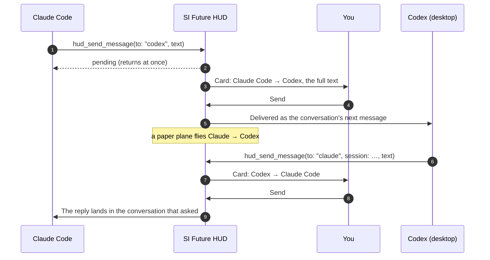

<strong>English</strong> · <a href="MESSAGING.zh-CN.md">简体中文</a>

# Agents messaging each other

Claude Code, Codex and Chengxiaobang (程小帮) can send each other messages through SI Future HUD. Claude can ask Codex how far the front end has got. Codex can ask Chengxiaobang what the company's rules say. Each reply comes back into the exact conversation that asked.

**Every message waits on the HUD until you press Send.**

  
  

## How a message travels

1. **An agent calls the HUD's `hud_send_message` tool** with:
   - `to`: one of `claude`, `codex` or `chengxiaobang`;
   - `session` *(optional)*: which conversation;
   - `text`: up to 4,000 characters.

   Without `session`, the message goes to the receiving agent's most recently active conversation that can receive.
2. **The call returns at once** with status *pending*. The sender doesn't wait for the answer.
3. **The HUD shows a card** with who sends to whom, the target conversation and the whole text. You can scroll through it.
4. **You choose:**
   - **Send**: a paper plane flies between their rings, and the text arrives as that conversation's next message.
   - **Deny**: the plane falls, and the sender learns the message was refused.
5. **Replies work the same way.** A delivered message names its sender and session, so the receiver replies with that `to` and `session`. The answer lands in the conversation that asked, not just anywhere.

## Who can send, who can receive

| | Sends | Receives | How it is delivered |
| --- | :---: | :---: | --- |
| **Claude Code** | ✓ | ✓ | Through the HUD's Claude Code plugin, into the open conversation |
| **Codex desktop** | ✓ | ✓ | Over Codex desktop's local IPC socket (`~/.codex/ipc/ipc.sock`), as a new turn in that conversation |
| **Codex CLI** | ✓ | – | It can send, but it can't receive, so it gets no replies |
| **Chengxiaobang 程小帮** | ✓ | ✓ | Through its HUD plugin, to the exact conversation that asked |
| Cursor, Grok Bot, others | – | – | Not supported |

## What each agent needs

| Agent | To send | To receive |
| --- | --- | --- |
| **Claude Code** | The HUD tools (`agent-hud` MCP). Added automatically if the `claude` command is installed. | The HUD's Claude Code plugin, also automatic. Conversations opened before the HUD was installed need `/reload-plugins`, or a new conversation. |
| **Codex** | The HUD tools in Codex. Added automatically if the `codex` command is installed. | The conversation must be in the **Codex desktop app** and **not in the middle of a turn**. |
| **Chengxiaobang** | Nothing: its HUD tools are written into `~/.chengxiaobang/mcp.json` on launch. | Enable the **SI Future HUD** plugin once. After each restart of Chengxiaobang, open the conversation once. After a HUD update, restart Chengxiaobang once. |

## Asking for it

Ask your agent in plain words, and mention the HUD:

> **In Claude Code:** *Use the HUD to ask Codex whether the trip card already shows the travellers, and wait for its answer.*

> **In Codex:** *Send Claude a message through the HUD: the API now returns `companions`, max 8.*

> **In Claude Code, for company knowledge:** *Use the HUD to ask Chengxiaobang what our booking rules say about the maximum number of travellers and how children are priced.*

The agent writes the message itself, so you see exactly what will be sent before you press Send.

## Rules that keep it safe

- **You approve every message.** Nothing moves between agents without your Send, and Deny drops it.
- **It never pretends to be you.** A delivered message is wrapped and marked as coming from another agent, so the receiver can't take it for your words. Chengxiaobang's plugin never treats it as your answer to a question.
- **It doesn't jump into a question.** A conversation that is waiting for *your* answer to a question can't receive messages.
- **Nothing piles up.** Each sender can have at most **2** messages waiting for your decision.
- **Codex isn't interrupted.** A Codex conversation in the middle of a turn refuses the message. There is no "steering". Try again when it is idle.
- **No duplicates.** If Codex's receipt is unclear after the write, the message counts as delivered and is not sent again.
- **Chengxiaobang to Chengxiaobang** must name a target session.

## Limits

- **Messages are not queued.** If the receiving conversation can't take a message right now, it is refused rather than stored for later:
  - it is closed;
  - it is busy (Codex);
  - it hasn't been opened since Chengxiaobang restarted.

  Ask again when it can.
- **Only Claude Code, Codex (desktop) and Chengxiaobang** take part. Cursor and Grok Bot do not.
- **The receiving agent processes the text like any prompt.** That means its model provider sees the text, just as if you had typed it there.

## Privacy

Messages go from one app to another on your Mac. The HUD sends nothing to any server of its own.

---

Next: **[Troubleshooting](TROUBLESHOOTING.md)** · Back to the **[Guide](GUIDE.md)** or the **[README](../../README.md)**
