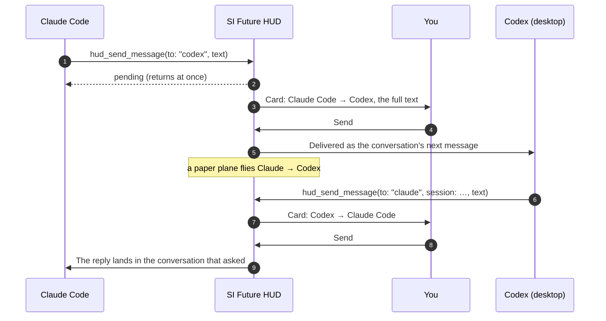

<p align="right"><strong>English</strong> · <a href="MESSAGING.zh-CN.md">简体中文</a></p>

# Agents messaging each other

Claude Code, Codex and Chengxiaobang (程小帮) can send each other messages through SI Future HUD. Claude can ask Codex how far the front end has got. Codex can ask Chengxiaobang what the company's rules say. Each reply comes back into the exact conversation that asked.

**Every message waits on the HUD until you press Send.**

<p align="center">
  
  
</p>

## How a message travels



1. **An agent calls the HUD's `hud_send_message` tool** — or, in a window opened before the HUD was set up, the HUD's `send` command line (see [From any window](#from-any-window)) — with:
   - `to`: one of `claude`, `codex` or `chengxiaobang`;
   - `session` *(optional)*: which conversation;
   - `text`: up to 4,000 characters.

   Without `session`, the message goes to the receiving agent's most recently active conversation that can receive.
2. **The call returns at once** with status *pending*. The sender doesn't wait for the answer.
3. **The HUD shows a card** with who sends to whom, the target conversation and the whole text. You can scroll through it.
4. **You choose:**
   - **Send**: a paper plane flies between their rings, and the text arrives as that conversation's next message.
   - **Deny**: the plane falls, and the sender learns the message was refused.
5. **Replies work the same way.** A delivered message names its sender and session, so the receiver replies with that `to` and `session`. The answer lands in the conversation that asked, not just anywhere.

## Who can send, who can receive

| | Sends | Receives | How it is delivered |
| --- | :---: | :---: | --- |
| **Claude Code** | ✓ | ✓ | Through the HUD's Claude Code plugin, into the open conversation |
| **Codex desktop** | ✓ | ✓ | Over Codex desktop's local IPC socket (`~/.codex/ipc/ipc.sock`), as a new turn in that conversation |
| **Codex CLI** | ✓ | – | It can send, but it can't receive, so it gets no replies |
| **Chengxiaobang 程小帮** | ✓ | ✓ | Through its HUD plugin, to the exact conversation that asked |
| Cursor, Grok Bot, others | – | – | Not supported |

## What each agent needs

Nothing, for new windows: the HUD sets everything up on its first launch. Windows that were already open work too:

| Agent | To send | To receive |
| --- | --- | --- |
| **Claude Code** | New conversations get the HUD tools (`agent-hud` MCP). Conversations opened earlier use the command line, which the `si-future-hud` skill teaches them; a new skill reaches open conversations at once. | The HUD's Claude Code plugin, set up automatically. A conversation opened before it needs `/reload-plugins` (or a new conversation) — but it still gets the answer to its own question by waiting on the command line. |
| **Codex** | The same: HUD tools in new conversations, the skill and the command line in older ones. In Codex's sandbox, allow the command to leave it when asked. | The conversation must be in the **Codex desktop app** and **not in the middle of a turn**. A command line that waits gets the reply anyway. |
| **Chengxiaobang** | Nothing: its HUD tools are written into `~/.chengxiaobang/mcp.json` on launch. | Enable the **SI Future HUD** plugin once in Chengxiaobang → Plugins (no restart needed). Settings → Agent plugins shows whether it is enabled, with a button that opens Chengxiaobang. |

Messaging doesn't depend on **Let agents arrange the HUD** or on **Answer questions**: those switches only cover the HUD tools and answering questions.

## From any window

Any agent that can run a command can send, whatever its tools. The command finds its own conversation (Claude Code's from the `claude` process it runs under, Codex's and Chengxiaobang's from their shells), and with `--wait` it prints the reply:

```bash
"/Applications/SI Future HUD.app/Contents/MacOS/agent-hud-next" send --to chengxiaobang --wait 1800 <<'EOF'
What meetings do I have today?
EOF
```

`--to` is `claude`, `codex` or `chengxiaobang`; `--session` names one conversation. Exit code 0 means sent (with the reply, when waiting), 2 no reply in time, 3 denied or never confirmed. The card shows that the message came from the command line.

## Asking for it

Ask your agent in plain words, and mention the HUD:

> **In Claude Code:** *Use the HUD to ask Codex whether the trip card already shows the travellers, and wait for its answer.*

> **In Codex:** *Send Claude a message through the HUD: the API now returns `companions`, max 8.*

> **In Claude Code, for company knowledge:** *Use the HUD to ask Chengxiaobang what our booking rules say about the maximum number of travellers and how children are priced.*

The agent writes the message itself, so you see exactly what will be sent before you press Send.

## Rules that keep it safe

- **You approve every message.** Nothing moves between agents without your Send, and Deny drops it (a sender waiting on the command line hears so).
- **It never pretends to be you.** A delivered message is wrapped and marked as coming from another agent, so the receiver can't take it for your words. Chengxiaobang's plugin never treats it as your answer to a question.
- **It doesn't jump into a question.** A conversation that is waiting for *your* answer to a question can't receive messages.
- **Nothing piles up.** Each sending conversation can have at most **2** messages waiting for your decision.
- **Codex isn't interrupted.** A Codex conversation in the middle of a turn refuses the message. There is no "steering". Try again when it is idle.
- **No duplicates.** If Codex's receipt is unclear after the write, the message counts as delivered and is not sent again.
- **Chengxiaobang to Chengxiaobang** must name a target session.
- **The command line's identity is checked.** It takes the calling conversation from the agent process it runs under, never from its arguments; a conversation the HUD doesn't list shows as unverified on the card.

## Limits

- **Chengxiaobang conversations queue; others don't.** A Chengxiaobang conversation that took messages before but isn't open now (Chengxiaobang restarted, say) gets the message once you open it, within an hour; the card says so. Other conversations that can't take a message now refuse it:
  - it is closed;
  - it is busy (Codex);
  - it never ran the HUD's plugin.
- **Only Claude Code, Codex (desktop) and Chengxiaobang** take part. Cursor and Grok Bot do not.
- **The receiving agent processes the text like any prompt.** That means its model provider sees the text, just as if you had typed it there.

## Privacy

Messages go from one app to another on your Mac. The HUD sends nothing to any server of its own.

---

Next: **[Troubleshooting](TROUBLESHOOTING.md)** · Back to the **[Guide](GUIDE.md)** or the **[README](../../README.md)**
