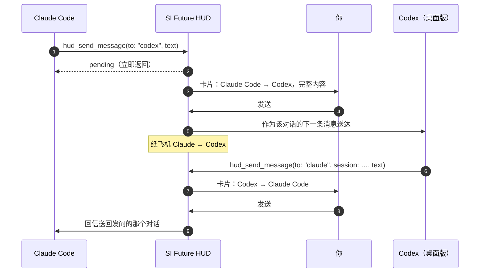

<p align="right"><a href="MESSAGING.md">English</a> · <strong>简体中文</strong></p>

# 助手之间互相传话

Claude Code、Codex 和程小帮可以通过 SI Future HUD 互相发消息。Claude 可以问 Codex 前端做到哪了，Codex 可以问程小帮公司规定是怎么写的。每条回信都会回到发问的那个对话。

**每一条消息都会先停在 HUD 上，等你点「发送」。**

<p align="center">
  
  
</p>

## 一条消息是怎么送到的



1. **助手调用 HUD 的 `hud_send_message` 工具**（HUD 装好之前就开着的窗口用 HUD 的 `send` 命令行，见[任何窗口都能发](#任何窗口都能发)），参数是：
   - `to`：`claude`、`codex` 或 `chengxiaobang` 之一；
   - `session`（可选）：发给哪个对话；
   - `text`：最多 4000 字。

   不填 `session` 时，发给对方最近活跃、而且能接收的那个对话。
2. **调用立刻返回**，状态是「待确认」，发送方不会干等回信。
3. **HUD 弹出卡片**：谁发给谁、发到哪个对话，以及完整内容（可以滚动看全）。
4. **你来决定：**
   - **发送**：纸飞机从发送方的圆环飞到接收方，内容作为那个对话的下一条消息送达。
   - **拒绝**：纸飞机掉下来，发送方会知道消息被拒了。
5. **回信也是同样的流程。** 送达的消息里写明了发送方和对话编号，接收方照着回 `to` 和 `session`，回信就会落回发问的那个对话，不会送错地方。

## 谁能发，谁能收

| | 发 | 收 | 怎么送达 |
| --- | :---: | :---: | --- |
| **Claude Code** | ✓ | ✓ | 通过 HUD 的 Claude Code 插件，送进打开着的对话 |
| **Codex 桌面版** | ✓ | ✓ | 通过 Codex 桌面版的本机 IPC（`~/.codex/ipc/ipc.sock`），在那个对话里开始新一轮 |
| **Codex 命令行版** | ✓ | – | 能发，但收不了，所以收不到回信 |
| **程小帮** | ✓ | ✓ | 通过它的 HUD 插件，送到发问的那个对话 |
| Cursor、Grok Bot 等 | – | – | 不支持 |

## 每个助手需要什么

新开的窗口什么都不用做：HUD 第一次启动时会自动配好。已经开着的窗口也能用：

| 助手 | 要能发 | 要能收 |
| --- | --- | --- |
| **Claude Code** | 新开的对话自带 HUD 工具（MCP 服务 `agent-hud`）。之前就开着的对话用命令行发：HUD 写入的 `si-future-hud` 技能会教它，而且新技能对已开的对话立刻生效。 | HUD 的 Claude Code 插件，自动安装。插件装好之前就开着的对话要 `/reload-plugins`（或者新开一个）才能收；不过它自己问的问题，用命令行等着也能拿到回信。 |
| **Codex** | 同上：新对话用 HUD 工具，旧对话用技能和命令行。Codex 的沙箱拦住命令时，按提示允许它出沙箱。 | 对话必须在 **Codex 桌面版**里，而且**不在一轮工作中途**。用命令行等着的话，回信照样能拿到。 |
| **程小帮** | 不用做什么：HUD 启动时会把工具写进 `~/.chengxiaobang/mcp.json`。 | 在程小帮 → 插件里启用一次 **SI Future HUD**（不用重启）。设置 → 智能体插件会显示它有没有启用，并有按钮直接打开程小帮。 |

传话不再受「让智能体排版 HUD」和「回答提问」这两个开关影响：它们只管 HUD 工具和回答提问。

## 任何窗口都能发

只要能跑命令，不管有没有 HUD 工具，任何智能体都能发。命令会自己认出是哪个对话在发（Claude Code 看它所在的 `claude` 进程，Codex 和程小帮看它们的命令行环境），加 `--wait` 时会把回信直接打印出来：

```bash
"/Applications/SI Future HUD.app/Contents/MacOS/agent-hud-next" send --to chengxiaobang --wait 1800 <<'EOF'
我今天有哪些会？
EOF
```

`--to` 写 `claude`、`codex` 或 `chengxiaobang`；`--session` 指定某个对话。退出码 0 表示已发出（等回信时附带回信），2 表示没等到回信，3 表示被拒绝或没人确认。卡片上会标明这条消息来自命令行。

## 怎么让它们传话

直接用大白话跟助手说，提一句「用 HUD」：

> **在 Claude Code 里：** 用 HUD 问问 Codex，行程卡片现在显示同行人了吗，等它回信。

> **在 Codex 里：** 通过 HUD 给 Claude 发条消息：接口现在会返回 `companions`，最多 8 个。

> **在 Claude Code 里，问公司业务：** 用 HUD 问问程小帮，公司的预订规则里同行人最多几位、儿童怎么计价。

消息是助手自己写的，你点「发送」之前就能看到要发出去的每一个字。

## 安全规则

- **每一条都要你批准。** 你不点「发送」，助手之间一条也传不过去；点「拒绝」就作废（在命令行等着的发送方会收到通知）。
- **不会冒充你。** 送达的消息会标明来自另一个助手，接收方不会把它当成你说的话。程小帮的插件也不会把它当成你对某个提问的回答。
- **不会插进提问里。** 正在等*你*回答提问的对话，收不了传话。
- **不会堆积。** 每个发送的对话最多只能有 **2** 条消息在等你处理。
- **不会打断 Codex。** Codex 的对话正在进行一轮工作时会拒收（不支持中途插话），等它停下来再发。
- **不会重复。** 写入后如果 Codex 的回执不明确，按已送达处理，不会重发。
- **程小帮发给程小帮**时，必须指定目标对话。
- **命令行发信会核实身份。** 发件对话来自命令所在的智能体进程，不看参数；HUD 不认识的对话，卡片上标「发件会话未核实」。

## 局限

- **程小帮的对话会排队，别的不会。** 以前收过消息、现在没开着的程小帮对话（比如程小帮刚重启过），消息会先排队，等你打开它时送达，一小时内有效，卡片上会写明。其他现在收不了的对话会直接拒收，比如：
  - 对话已经关了；
  - Codex 正忙；
  - 从没加载过 HUD 插件。
- **只有 Claude Code、Codex（桌面版）和程小帮**能参与，Cursor 和 Grok Bot 不行。
- **接收方会像处理普通提示词一样处理这段文字**，也就是说，它的模型服务商会看到这段内容，和你亲手打进去一样。

## 隐私

消息只在你电脑上的几个 App 之间传递，HUD 不会把它发到任何自己的服务器。

---

接下来：**[常见问题](TROUBLESHOOTING.zh-CN.md)** · 回到 **[使用指南](GUIDE.zh-CN.md)** 或 **[首页](../../README.zh-CN.md)**
